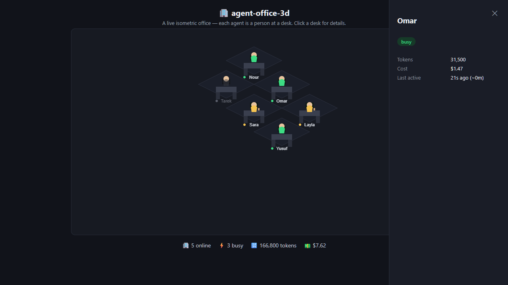

# agent-office-3d

مكتب إيزومتري حي بالكامل — كل "agent" (وكيل/عملية) يظهر كموظف واقف على مكتبه: مشغول (busy) 🟢، متصل بلا نشاط (idle) ☕، أو غير متصل (offline) ⚫.



## أصل الفكرة وعلاقتها بمشاريع أخرى

الفكرة العامة — "عرض حالة الوكلاء كموظفين في مكتب إيزومتري" — مستوحاة من فكرة مشروع [`hermes-desktop-plugin-office-3d`](https://github.com/oslook/hermes-desktop-plugin-office-3d) (plugin لتطبيق Hermes Desktop).

**هذا المستودع كود جديد بالكامل من الصفر — لا يوجد فيه أي سطر كود، أو نص، أو صورة منسوخة من ذلك المشروع.** لا يعتمد عليه كاعتمادية، ولا يحتاجه للتشغيل. الفرق الجوهري:

| | hermes-desktop-plugin-office-3d (الأصل) | agent-office-3d (هذا المشروع) |
|---|---|---|
| **يحتاج** | تطبيق Hermes Desktop (GUI) + dashboard backend بايثون | متصفح فقط — صفحة HTML واحدة |
| **المنصّات** | Linux / macOS فقط (قيد أمان حقيقي في فحص العمليات) | أي نظام، **بما فيه Windows** |
| **مصدر البيانات** | يقرأ `state.db`/`gateway_state.json` لكل profile حقيقي | ملف JSON بسيط (`sample-data/agents.json`) — تقدر تستبدله بأي مصدر بياناتك |
| **التنفيذ** | Canvas 2D داخل SDK خاص بـHermes | Canvas 2D خام، JavaScript عادي، بدون أي SDK خارجي |

الرخصة MIT في كلا المشروعين، ومفيش أي التباس في الملكية — الفكرة العامة غير محمية بحق النشر، والكود هنا أصلي.

## التشغيل

بدون أي تثبيت — افتح `index.html` في المتصفح مباشرة، أو شغّل سيرفر محلي بسيط (مطلوب بسبب `fetch` لملف JSON):

```bash
python3 -m http.server 8080
# افتح http://localhost:8080
```

## البيانات

عدّل `sample-data/agents.json` لتشابه وكلاءك/عملياتك الحقيقية. كل عنصر:

```json
{ "id": "a1", "name": "Nour", "status": "busy", "tokens": 48200, "cost": 2.14, "lastActive": 5 }
```

`status` واحدة من: `busy` / `idle` / `offline`. `lastActive` بالثواني.

## إلى أين تطويرها من هنا؟

ده بروتوتايب بسيط مقصود يكون قاعدة تطوّرها بطريقتك: وصله بمصدر بيانات حقيقي (API/قاعدة بيانات)، زوّد شخصيات/حركات، أو حوّل الـCanvas إلى WebGL/three.js لاحقًا لو حبيت.

## الترخيص

MIT — انظر [LICENSE](./LICENSE).
